


 

 


   
   
   
  

  
  
  
  
  
  

  <a href="https://nimolabs.in"></a>

  <a href="https://github.com/kartik11m"></a>
  <a href="https://github.com/kartik11m"></a>

  
  
   
  <a href="https://coursera.org/verify/specialization/EG1QQTL2AE2K"></a>
  
  


  
  
   
  
   
  
   
  

  <picture>
    <source media="(prefers-color-scheme: dark)" srcset="https://raw.githubusercontent.com/kartik11m/kartik11m/output/github-snake-dark.svg" />
    <source media="(prefers-color-scheme: light)" srcset="https://raw.githubusercontent.com/kartik11m/kartik11m/output/github-snake.svg" />
    
  </picture>

**Open to full stack / MERN roles, freelance quests and co-op projects.**

📧 **kartikmaheshwari698@gmail.com** &nbsp;|&nbsp; 🔗 **[linkedin.com/in/kartik-maheshwari-267ba5376](https://linkedin.com/in/kartik-maheshwari-267ba5376)**


